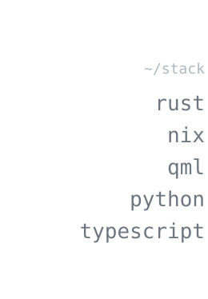
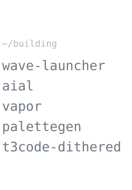

  <picture>
    <source media="(prefers-color-scheme: dark)" srcset="side-stack-dark.svg">
    
  </picture>
  <picture>
    <source media="(prefers-color-scheme: dark)" srcset="side-building-dark.svg">
    
  </picture>
   
  <picture>
    <source media="(prefers-color-scheme: dark)" srcset="kalkaro-gray-dark.gif">
    
  </picture>

